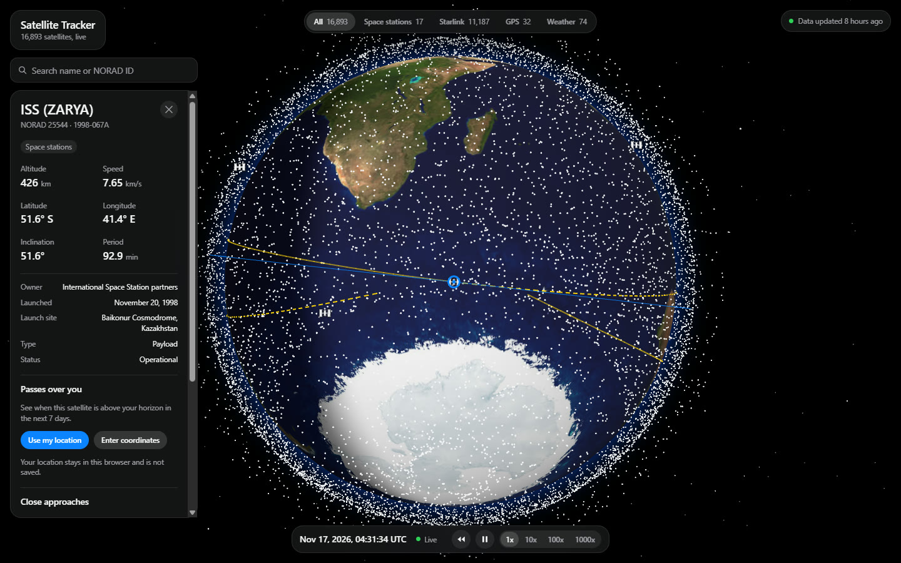

# Satellite Tracker

[](https://github.com/PathNotFound404/Satellite-Fable-Tracker/actions/workflows/ci.yml)

About 17,000 real satellites moving in real time on an interactive 3D globe. Orbital data comes from [CelesTrak](https://celestrak.org), positions are computed in the browser with SGP4, and everything is drawn in a single three.js point cloud. No backend, no cost.

**Live site:** https://satellite-fable-tracker.vercel.app



## What it does

- **Every active satellite, live.** The full CelesTrak active catalog, refreshed every 6 hours, moving at the right speed in the right place.
- **Click any satellite** for its altitude, speed, ground position, inclination and period, plus its owner, launch date, launch site, type and status. Its orbit is drawn in blue and its ground track in yellow: solid for the orbit just flown, dashed for the one ahead.
- **Search and filter.** Search by name or NORAD ID (press `/`). Filter to space stations, Starlink, GPS or weather satellites. Space stations carry their own glyph.
- **Time controls.** Pause, run up to 1000x, or run backwards; Space toggles pause and "Back to now" returns to live. Day and night follow the simulated time.
- **Passes over you.** When the selected satellite is above your horizon in the next 7 days, in your local time, with how high it gets. Your location never leaves the browser and is not stored.
- **Close approaches.** Scans the whole catalog for satellites passing within 50 km of the selected one in the next 24 hours. Select a result to jump to that moment. This is a demonstration, not a collision assessment.

Useful links: `?sat=25544` opens straight on the ISS (any NORAD ID works), and `?debug` shows frame rate and propagation cost.

## How it works

```
CelesTrak ──(GitHub Actions, every 6 h)──> validate ──> static JSON on Vercel ──> browser
                                                                                    │
                                              SGP4 (satellite.js) ── TEME→ECF ── one THREE.Points
```

**Data pipeline.** The browser never calls CelesTrak. A scheduled GitHub Actions workflow downloads the orbital elements (CCSDS OMM in JSON), validates them and deploys them to Vercel as one static file. If a download fails or looks wrong (too few records, malformed records, missing ISS), nothing is deployed and the site keeps the last good data. The workflow follows [CelesTrak's fair-use rules](docs/ci-cd.md#celestrak-fair-use): one download per group per update, stop on the first error, no retries. Data is deployed, never committed ([ADR 0001](docs/adr/0001-deploy-data-with-vercel-cli.md)).

**Orbit math.** Each satellite is propagated in the browser with SGP4 via [satellite.js](https://github.com/shashwatak/satellite-js). SGP4 gives positions in the inertial TEME frame; one function rotates them by Greenwich sidereal time into the Earth-fixed frame so they sit correctly over a turning Earth. `src/orbital/` is pure TypeScript with no Vue or three.js imports, and is tested against independent references: Vallado's published SGP4 verification vectors, solstice and equinox Sun positions, Skyfield pass predictions, and a brute-force close-approach search.

**Rendering.** All satellites are one `THREE.Points` object: one draw call. Running SGP4 for 17,000 satellites every frame costs more than a frame, so each satellite is re-propagated about once a second (a slice of the catalog per frame) and the vertex shader extrapolates its position in between, which keeps motion smooth at any frame rate and at 1000x ([ADR 0002](docs/adr/0002-propagation-strategy.md)). Picking is done in screen space, and three.js objects are kept out of Vue's reactivity.

**Time.** One simulation clock is the only source of "now". Everything that depends on time reads it, so pausing, fast-forwarding and reversing just work everywhere.

More detail: [architecture](docs/architecture.md), [data contract](docs/data-contract.md), [CI/CD](docs/ci-cd.md).

## Accuracy

Treat positions as approximate.

- Public orbital elements are good to about a kilometre when they are issued and drift by kilometres per day. The app shows how old its data is and limits the time controls to 7 days either side of it.
- Altitude is height above a spherical Earth, within about 20 km of true geodetic height.
- Pass times ignore atmospheric refraction, and "above the horizon" does not mean visible to the eye.
- Close approaches are for illustration only. Real conjunction assessment needs far better data than is public.

## Stack

Vue 3 (Composition API) + Vite + TypeScript (strict), three.js, satellite.js, Vitest, ESLint, GitHub Actions, Vercel.

## Run it locally

Needs Node 24 (see `.nvmrc`).

```sh
npm ci
npm run dev
```

| Task | Command |
|---|---|
| Dev server | `npm run dev` |
| Build | `npm run build` |
| Preview the build | `npm run preview` |
| Unit tests | `npm test` |
| Type check | `npm run typecheck` |
| Lint | `npm run lint` |

The dev server and build use the copy of the data on the live site, or `public/data/sample.json` (50 satellites) if that can't be reached. `npm run fetch-data` downloads the full catalog from CelesTrak; please read [CelesTrak fair use](docs/ci-cd.md#celestrak-fair-use) first, since each run counts against your IP.

## Project docs

- [Roadmap](docs/roadmap.md): milestones and acceptance criteria, including what is still unverified
- [Project brief](docs/project-brief.md)
- [Architecture](docs/architecture.md)
- [Data contract](docs/data-contract.md)
- [CI/CD and CelesTrak fair use](docs/ci-cd.md)
- [Decisions (ADRs)](docs/adr/)

## Credits

- Orbital data and satellite catalog: [CelesTrak](https://celestrak.org) (Dr. T.S. Kelso). Please respect its [usage policy](https://celestrak.org/usage-policy.php).
- SGP4 implementation: [satellite.js](https://github.com/shashwatak/satellite-js).
- Earth imagery: NASA Blue Marble (public domain), via [Wikimedia Commons](https://commons.wikimedia.org/wiki/File:Land_ocean_ice_2048.jpg).
