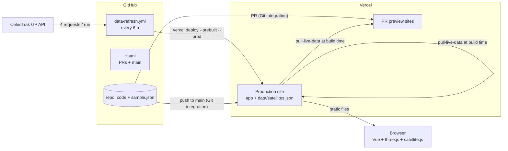

# Architecture

A static web app. A scheduled GitHub Actions workflow fetches orbital data from CelesTrak and deploys it as a static JSON file to Vercel. The browser loads that file once, runs SGP4 (satellite.js) locally and renders every satellite in a single three.js points object. There is no backend.

Related docs: [project brief](project-brief.md), [roadmap](roadmap.md), [CI/CD plan](ci-cd.md), [data contract](data-contract.md), [ADRs](adr/).

## System overview



Key points:

- **Only `data-refresh.yml` ever talks to CelesTrak.** Neither the browser nor Vercel builds call it.
- **Data is deployed, not committed.** See [ADR 0001](adr/0001-deploy-data-with-vercel-cli.md). The repo only holds a small `sample.json`.
- **Every build gets data the same way:** if `public/data/satellites.json` doesn't exist yet, `scripts/pull-live-data` downloads it from the production site, falling back to `sample.json`. The data-refresh workflow writes the fresh file first, so the pull step skips.
- **The last good file is always the one live.** If a fetch or validation fails, the workflow does not deploy, so production keeps serving the previous data.

## Two deploy paths

| Trigger | Who builds | Data used | Deploy |
|---|---|---|---|
| Push to `main` | Vercel (Git integration) | Current production data via `pull-live-data` | Production |
| Pull request | Vercel (Git integration) | Current production data via `pull-live-data` | Preview URL |
| Schedule (every 6 h) or manual | GitHub Actions + Vercel CLI | Freshly fetched and validated data | Production |

Both paths produce the same build output. The only difference is where `satellites.json` comes from.

## Front-end structure

```
src/
  types/        data contract types (SatelliteFile, OmmRecord, ...)
  orbital/      pure TS: satrec creation, propagation, TEME->ECF, altitude,
                speed, look angles, pass prediction. No Vue, no three.js.
  three/        scene, camera, controls, globe, point cloud, orbit line,
                picking, unit conversion (km -> scene units)
  composables/  useSatellites (load + index data), useSelection,
                useSimClock, useFilters
  components/   InfoPanel, SearchBox, GroupFilter, DataAgeBadge, ...
  App.vue
  main.ts
```

### Layer rules

- `orbital/` depends only on `satellite.js` and `types/`. Easy to unit test.
- `three/` depends on `orbital/` and `types/`. It never imports Vue.
- `composables/` and `components/` glue it together. three.js objects are created outside Vue reactivity (module-level variables or `markRaw`), and only small values (selected ID, filter state, panel numbers) are reactive.

## Data flow at runtime

1. **Load:** `useSatellites` fetches `/data/satellites.json` once, checks `schemaVersion`, and builds `satrec`s from the OMM records. Records that fail to parse are dropped and counted.
2. **Index:** keep satellites in plain arrays indexed by a stable position `i`. That index is shared by the satrec array, the position buffer, the filter mask and picking. Groups are resolved to index sets once.
3. **Clock:** `useSimClock` is the single source of simulation time. `useTimeControls` drives it from the UI (pause, 1x to 1000x, reverse, back to now) and keeps it within 7 days of the data and the present.
4. **Propagate:** each frame, a slice of the catalog (sized so every satellite is refreshed about once a second) goes through `propagateEcf(satrec, simTime)`: TEME state (km, km/s) → ECF via GMST → scene units → written into shared `Float32Array`s for position, velocity and the time they were computed. Failures hide that point (see below).
5. **Render:** one `THREE.Points` whose vertex shader draws each point at `position + velocity * (now - time0)`, so motion is smooth between refreshes. Only the refreshed slice is uploaded.
   Space stations get a small glyph on top: a second `THREE.Points` (`three/stationLayer.ts`) with one vertex per station, drawn in its fragment shader. Members of the `stations` group within 50 km of each other share one glyph, since every docked module is its own catalog entry.
6. **Select:** a click is matched to the nearest drawn point in screen space; the hit index maps back to the satellite. The info panel reads altitude, speed and ground position from `orbital/` helpers for that one satellite four times a second. The orbit line is one period sampled in the inertial frame (a closed ellipse), rotated about the polar axis each frame as the Earth turns and re-sampled every 20 s. The ground track is the direction to the satellite sampled in the Earth-fixed frame for one period either side of now, drawn just above the surface as two-pixel wide lines (three's `LineSegments2`, since plain WebGL lines are always one pixel): solid behind the satellite and dashed ahead, so the direction of travel is readable. Being Earth-fixed it needs no per-frame rotation, only a re-sample every 5 s so the join stays under the satellite.
7. **Passes:** `orbital/passes.ts` scans the selected satellite's elevation above the observer's horizon every 30 s across the next 7 days of simulation time, then refines each horizon crossing by bisection and each peak by ternary search to half a second. The observer sits on the WGS84 ellipsoid. One search is about 20,000 SGP4 calls (about 15 ms), so it runs on the main thread when the selection or location changes and then at most once per hour of simulation time; in between, the list is only trimmed as passes end. Elevation is geometric: no refraction and no check that the satellite is sunlit. The observer's location lives in memory only (`useObserverLocation`); it is never stored or sent anywhere.

## Frames, units and constants

These rules exist because frame and unit bugs are silent.

| Concept | Rule |
|---|---|
| satellite.js output | TEME frame, km and km/s |
| Earth-fixed | `orbital/frames.ts` converts TEME→ECF with GMST (`satellite.gstime`). Single function, unit-tested. |
| Earth radius | One constant, `EARTH_RADIUS_KM = 6378.137` (WGS84 equatorial), in `orbital/constants.ts` |
| Altitude | `‖r‖ − EARTH_RADIUS_KM` (spherical approximation; accurate enough for display) |
| Speed | `‖v‖` in km/s |
| Scene units | 1 scene unit = 1 Earth radius. The only km→scene conversion lives in `three/units.ts`. |
| Axes | ECF has z toward the North Pole; three.js is y-up. Remap axes in the same `three/units.ts` function, and align the Earth texture to match (tested visually against a known ground position). |

Because positions are converted to ECF, the Earth mesh does not rotate with time; the satellites move relative to it.

## Day and night

`orbital/sun.ts` gives the Sun's direction in the Earth-fixed frame (satellite.js's low-precision solar position, rotated by GMST like everything else). `useSunlight` recomputes it whenever simulation time has moved 20 s and hands it to the globe, whose standard material has a few lines added to its fragment shader: brightness is scaled between a night level and full by the cosine of the Sun angle, with a soft band about 7 degrees either side of the terminator. No second mesh, light or draw call. The camera-mounted light still provides the base shading, so relief reads the same from any angle.

## Propagation strategy (decided in M3)

Measured in M3: a full SGP4 pass over the 16,895-satellite catalog takes about 26 ms, more than a frame. So each satellite is re-propagated about once a second on the main thread, a slice per frame (about 0.45 ms), and the vertex shader extrapolates in between from the Earth-fixed position and velocity, with gravity and rotating-frame terms so it stays accurate when the clock runs fast (`three/extrapolation.ts`). Details, numbers and the alternatives (Web Worker, WASM bulk propagator) are in [ADR 0002](adr/0002-propagation-strategy.md).

## Invalid and decayed satellites

- satellite.js can return `false` or a position containing `NaN` for decayed or bad elements.
- A result more than 100 km below the surface is treated the same way (SGP4 can keep producing numbers for an object that has re-entered).
- Such satellites are marked invalid: their point is masked in the shader (moved outside the clip volume), never left at the origin or the last good position.
- They're excluded from search results and counted in a debug readout (add `?debug` to the URL).

## Picking

- Screen-space picking (`three/picking.ts`): each shown satellite is projected to pixels and the nearest one within a tolerance (10 px for a mouse, 22 px for touch) wins, skipping any hidden behind the Earth. This replaced the planned `THREE.Raycaster` because points are moved in the vertex shader, so the raw position buffer a raycaster reads is up to a second stale, and a pixel tolerance behaves the same at every zoom. It is O(n) per click: well under a millisecond for 17k points.
- Hover highlighting (if added) would need a cheaper method (throttling or GPU color-ID picking). Decide when needed.

## Accuracy and data age

- GP/SGP4 accuracy is on the order of a kilometer at epoch and degrades over days. On top of that, the app uses UTC as UT1 (up to about 0.45 km east-west at low orbit) and ignores polar motion (about 15 m); see `src/orbital/frames.ts`. The UI never shows more than 1 decimal place of km and never implies sub-kilometer accuracy.
- `DataAgeBadge` shows the age from `generatedAt`. Above 24 hours old it shows a warning (the pipeline is probably failing).
- Each record's own `EPOCH` can be older than `generatedAt`. The info panel shows the epoch.

## Performance rules

- One draw call for all satellites.
- No allocations in the render loop: preallocate vectors, typed arrays and the GMST/rotation scratch values.
- Filtering updates a mask (size attribute or alpha) instead of rebuilding geometry.
- Satellite data is not deep-reactive. Store arrays with `shallowRef` or outside Vue.
